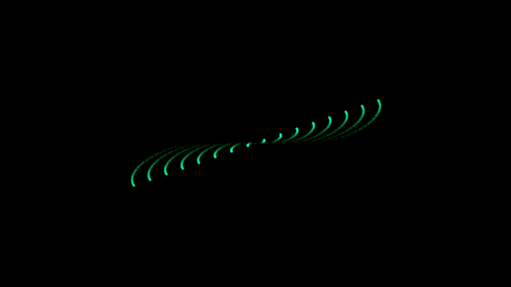
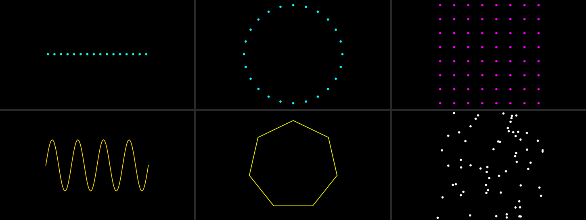
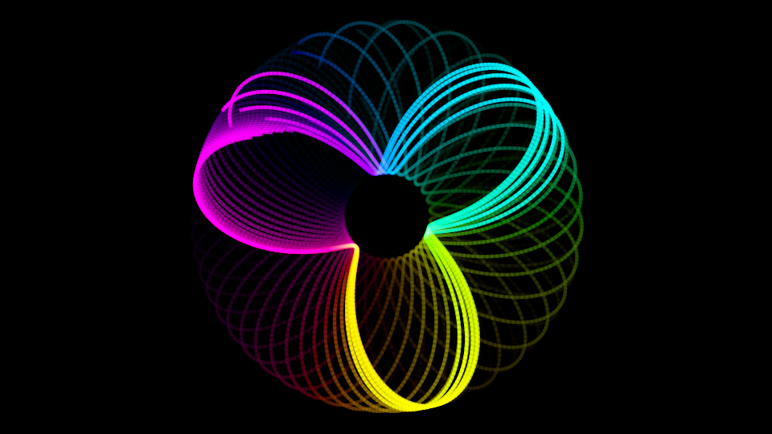
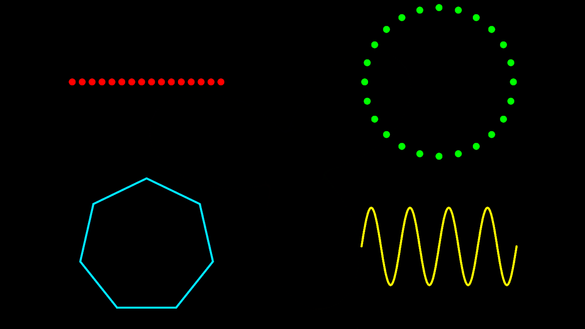

<h1 align="center">BudgetLaser</h1>

<p align="center"><b>Turn a video projector into a DMX laser-effect fixture. Add haze, get beams.</b></p>

<p align="center">Free and open source. Patch it on any lighting desk over Art-Net, sACN or DMX USB Pro,
and play your own ILDA animations from the same cue list as the rest of your rig.</p>

<p align="center">
  <a href="https://github.com/Timdebruijn/budgetlaser/actions/workflows/ci.yml"></a>
  <a href="LICENSE"></a>
</p>

<p align="center">
  
</p>
<p align="center"><sub>Renderer output: what the projector shows, not a photo of a hazy room.</sub></p>
<!-- TODO: add a photo or short video of real beams in haze. -->

## What it is

Put a projector in haze and every lit pixel becomes a visible beam from the lens. BudgetLaser
draws laser-style line art fullscreen and shows up on your desk as a lighting fixture, so a
plain projector behaves like a scanner with no moving parts. There is no laser source in the
device: all light is your projector's.

- **A real DMX fixture.** Art-Net, sACN (E1.31) or Enttec DMX USB Pro; 13, 14, 17 or 18 channel
  modes; a QLC+ fixture definition is included.
- **ILDA from your lighting desk.** Pick a `.ild` file and its speed on two DMX channels.
- **Several lasers on one projector.** Split the output into zones, one fixture per zone.
- **Free and open.** MIT license, one binary and one config file. Runs on macOS, Windows, Linux
  and the Raspberry Pi 5.

## Quick start

You need a [Rust toolchain](https://rustup.rs). No lighting desk is needed to try it.

```bash
git clone https://github.com/Timdebruijn/budgetlaser && cd budgetlaser
cargo build --release
./target/release/budgetlaser budgetlaser.toml     # fullscreen; Esc quits
```

Then, from a second terminal, send it some DMX over Art-Net (plain Python, nothing to install):

```bash
tools/dmx_test.py --pattern tunnel --beams 64
tools/dmx_test.py --pattern fan --color 255,0,80
tools/dmx_test.py --pattern ilda --file 0 --color 255,255,255   # ilda/demo.ild
```

Point the projector at the room, switch the lights off and the hazer on.

## Made for show night

- **Club night or DJ set.** A tunnel on the drop and a fan on the build, on a fader, from the
  same desk that runs the wash and the movers.
- **Church, school play or theatre.** Cue a polygon or a twinkle field per scene, fade it with
  the rest of the rig, and black it out with the master.
- **Programming ILDA content without a laser.** Build and test the cue list at your desk. Real
  beams in haze will look different from a screen, so check on site.

## Patch it like any fixture

Channels 1-13 are the same in every mode, so a show programmed in 13ch survives a switch to 18ch.

| Mode | Channels |
|---|---|
| 13ch | mode, pattern, size, rotation, pan, tilt, red, green, blue, dimmer, strobe, beams, animation speed |
| 14ch | 13ch + beam width |
| 17ch | 13ch + 16-bit fine size, rotation, pan and tilt for smooth slow moves |
| 18ch | 17ch + beam width |

BudgetLaser answers ArtPoll, so Art-Net desks can discover it. Several desks or sources can
drive it at once (highest priority wins, equal priority merges HTP), and it interpolates between
DMX frames so motion stays smooth. If the signal drops, it blacks out after 3 s, or holds the
last look if you prefer.

The QLC+ definition is in [fixtures/](fixtures/BudgetLaser-Beamer-Laser.qxf), with all four modes
and pan/tilt presets for the EFX editor. On another desk, build the fixture from the channel
tables in [docs/reference.md](docs/reference.md).

## What it draws

Channel 2 picks the pattern: dot, line, circle, fan and tunnel (1-64 beams), grid (up to 8x8),
twinkle (1-64 dots), wave (1-8 cycles), polygon (3-12 sides) or an ILDA file. Size, rotation
(fixed angle or spinning either way, up to 2 turns a second), pan, tilt, colour, dimmer and
strobe (up to 25 Hz) work on all of them.

<p align="center">
  
</p>
<p align="center"><sub>Fan, tunnel, grid, wave, polygon, twinkle. Each dot is a beam once there is haze in the room.</sub></p>

**Beam width** (14ch and 18ch) scales the line width per fixture from 0.5x to 8x, so a dim
projector can draw fatter beams and a bright one finer ones.

## Your own ILDA files, from the desk

Playing your own laser animations usually means a laser DAC plus show software, and QLC+ users
have [asked for ILDA playback](https://forum.qlcplus.org/viewtopic.php?p=58575). Here a `.ild`
file is just another pattern:

| Channel | Value | Does |
|---|---|---|
| 2 (pattern) | 180-199 | play an ILDA file |
| 12 (beams) | 0-255 | which file: the files in `ilda/`, sorted by name, counted from 0 |
| 13 (animation speed) | 0 / 128 / 255 | hold the first frame / 30 fps / twice as fast |

<p align="center">
  
</p>
<p align="center"><sub>An ILDA animation, renderer output.</sub></p>

At red = green = blue = 255 the file shows its own colours; lower values tint it. Size,
rotation, pan, tilt, dimmer and strobe apply too. ILDA formats 0, 1, 2, 4 and 5 are supported.

## Several lasers, one projector

Each `[[fixture]]` block in the config gets its own DMX address, mode and zone: a rectangle of
the output. Four zones make four independent "lasers" from one projector.

<p align="center">
  
</p>
<p align="center"><sub>Four fixtures in four quadrants of one output, renderer output.</sub></p>

## How it compares

| | Lights up a projector | Patchable DMX fixture | Plays ILDA |
|---|---|---|---|
| **BudgetLaser** | yes | yes | yes |
| Laser show previewers | no, they draw on a monitor | they take DMX in | yes, for a real laser |
| Audio-driven projector beam tools | yes | no | no |
| VJ and media software | as content you build yourself | DIY | via add-ons for real lasers |
| Entry-level DMX lasers | n/a, a real laser | yes, preset patterns | often not |

We found no other tool that does all three (checked 2026-10-30). Products, prices and sources
are in [docs/comparison.md](docs/comparison.md).

## Raspberry Pi 5 appliance

`deploy/install.sh` turns a Pi 5 into a box that boots straight into the output: a kiosk on the
HDMI port, a systemd service, managed over SSH. CI builds and tests the Pi binary. The target is
1080p60 with glow, which **has not been measured on a Pi yet**; [docs/raspberry-pi.md](docs/raspberry-pi.md)
shows how to install it and measure it. Pi Zero and Pi 3 are not supported: their GPU lacks the
graphics API the renderer needs.

## Limitations

- **A projector is not a laser.** It is dimmer and softer, it needs haze and a dark room, and
  how well beams read depends on its brightness and your haze. Its black level shows as a faint
  glow cone.
- **No scan flicker yet.** ILDA files play at a fixed frame rate (30 fps by default).
- **Not a replacement for a certified show laser,** and it cannot take a laser DAC signal yet
  (see the roadmap).

## Safety

BudgetLaser adds no light of its own, but your projector and your venue still have rules:

- **Laser-phosphor ("laser") projectors are laser products.** The FDA classifies them under
  [Laser Notice 57](https://www.fda.gov/regulatory-information/search-fda-guidance-documents/classification-and-requirements-laser-illuminated-projectors-lips-laser-notice-no-57),
  and Risk Group 3 projectors have a hazard distance. Read the projector manual and keep people
  out of that distance.
- **Don't point it into the audience** unless the projector manual allows it.
- **Check venue rules and local permits** before you rig.
- **Haze can set off smoke detectors.** Talk to the venue first.

## Roadmap

Not built yet:

1. **Network laser DAC emulation** (Ether Dream, then IDN), so laser show software can drive the
   projector as if it were a laser.
2. **Analogue ILDA input** (DB25), so a real laser DAC can drive it.

## Documentation

- [docs/reference.md](docs/reference.md): inputs and merging, channel tables, patterns, ILDA,
  output and config options, platform notes.
- [docs/raspberry-pi.md](docs/raspberry-pi.md): Pi 5 build, install, logs and the performance test.
- [docs/comparison.md](docs/comparison.md): alternatives, with sources.
- [budgetlaser.toml](budgetlaser.toml): the config; every key is optional and commented.

## Contributing

Issues and pull requests are welcome, one topic per pull request. Especially wanted: photos or
video of BudgetLaser in real haze, and Pi 5 measurements. Run the tests with `cargo test`.

## License

[MIT](LICENSE)
