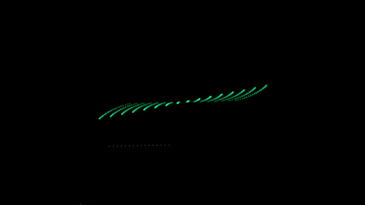
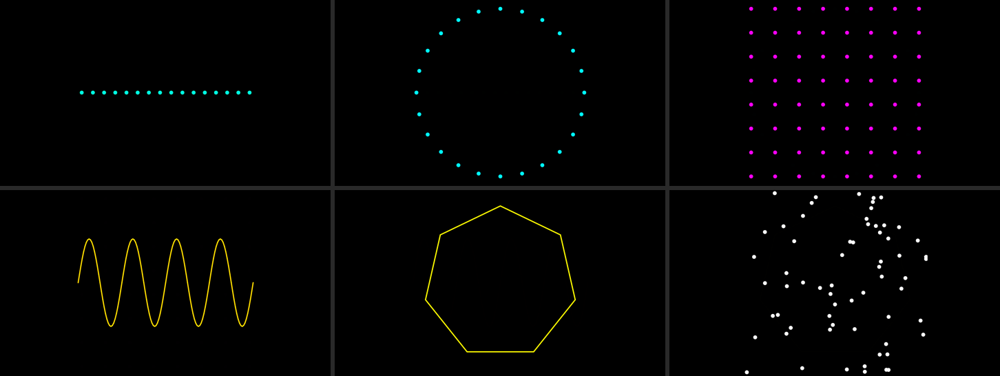
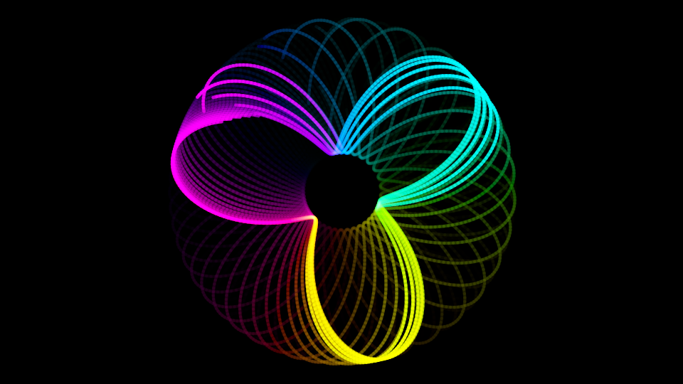
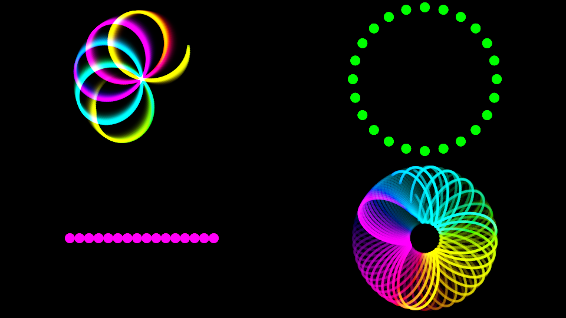

<h1 align="center">BudgetLaser</h1>

<p align="center"><b>Patch your projector like a laser. Add haze, get beams.</b></p>

<p align="center">A free DMX fixture for the video projector you already own.<br>
Art-Net, sACN, ILDA files and laser show software in. Fans, tunnels and line art out.</p>

<p align="center">
  <a href="https://github.com/Timdebruijn/budgetlaser/actions/workflows/ci.yml"></a>
  <a href="LICENSE"></a>
</p>

<p align="center">
  
</p>
<p align="center"><sub>Renderer output: what the projector shows, not a photo of a hazy room. In haze, every lit pixel becomes a beam.</sub></p>

<p align="center">
  <b>Art-Net</b> &middot; <b>sACN</b> &middot; <b>Enttec DMX USB Pro</b> &middot; <b>ILDA .ild</b> &middot; <b>Ether Dream</b> &middot; <b>IDN</b> &middot; <b>QLC+ fixture</b>
  <br>
  <a href="https://github.com/Timdebruijn/budgetlaser/releases/latest"><b>Download</b></a> &middot; <a href="#try-it-without-hardware">Try it</a> &middot; <a href="#why-not-something-else">Why not something else?</a> &middot; <a href="docs/reference.md">Reference</a>
</p>

## The idea

Point a projector into haze and every lit pixel is a visible beam from the lens. BudgetLaser
draws laser-style line art fullscreen and shows up on your desk as a lighting fixture, so a plain
projector works like a scanner with no moving parts.

It is a **laser look**, not a laser. BudgetLaser is software and adds no light of its own: every
beam is your projector's.

**Made for** school and theatre techs, club and mobile DJs, VJs, and laser programmers who want
to see a show without a laser on the desk.

## Try it without hardware

No desk, no projector and no haze needed to see it work. Download the archive for your system
from [Releases](https://github.com/Timdebruijn/budgetlaser/releases/latest) (Linux x86_64,
Raspberry Pi and other aarch64 Linux, macOS, Windows), unpack it and start it from a terminal in
that folder:

```bash
./budgetlaser budgetlaser.toml     # fullscreen; Esc quits. Windows: budgetlaser.exe
```

The builds are not signed yet. macOS blocks a downloaded binary until you run
`xattr -dr com.apple.quarantine .` in the folder; Windows SmartScreen asks you to confirm with
More info, Run anyway.

In a second terminal, drive it over Art-Net with plain Python (nothing to install; on Windows,
start each line with `python`):

```bash
tools/dmx_test.py --pattern tunnel --beams 64
tools/dmx_test.py --pattern fan --color 255,0,80
tools/dmx_test.py --pattern ilda --file 0 --color 255,255,255   # ilda/demo.ild
```

Then point the projector at the room: lights off, hazer on.

<details>
<summary><b>Build from source</b></summary>

With a [Rust toolchain](https://rustup.rs):

```bash
git clone https://github.com/Timdebruijn/budgetlaser && cd budgetlaser
cargo build --release
./target/release/budgetlaser budgetlaser.toml
```

</details>

## What you get

**A real DMX fixture, not a visualiser.** Art-Net (it answers ArtPoll, so desks find it), sACN
and Enttec DMX USB Pro. 13, 14, 17 or 18 channels, with 16-bit fine size, rotation, pan and tilt
for slow, smooth moves. Two desks at once? Highest priority wins, equal priority merges HTP. Lose
the signal and it blacks out after 3 s, or holds the look if you prefer. A
[QLC+ fixture definition](fixtures/BudgetLaser-Beamer-Laser.qxf) is included; on other desks,
build the fixture from the [channel tables](docs/reference.md).

**Ten looks on one channel.** Dot, line, circle, fan and tunnel (up to 64 beams), grid, twinkle,
wave, polygon and ILDA. Rotation fixed or spinning, strobe up to 25 Hz, colour, dimmer, pan and
tilt work on all of them. A tunnel on the drop, a fan on the build, from the same desk that runs
the wash and the movers.

<p align="center">
  
</p>
<p align="center"><sub>Fan, tunnel, grid, wave, polygon, twinkle, as the projector draws them. Each dot is a beam in haze: the row of dots is a fan, the ring a tunnel.</sub></p>

**Your own ILDA animations, from a fader.** DMX presets for the standard stuff, ILDA for your
own: channel 2 at 180-199 plays a `.ild` file, channel 12 picks which one and channel 13 sets the
speed. QLC+ users [asked for this](https://forum.qlcplus.org/viewtopic.php?p=58575). Formats 0,
1, 2, 4 and 5.

<p align="center">
  
</p>
<p align="center"><sub>An ILDA animation, renderer output.</sub></p>

**Laser show software, projector as the output.** Enable `[etherdream]` or `[idn]` in the config
and BudgetLaser shows up on the network as an Ether Dream DAC or an IDN projector. A stream
fills its own zone without any DMX, or you cue it from the desk on channel 2 with dimmer, size,
pan and tilt. Programs that list Ether Dream or IDN output include MadLaser, Modulaser,
Liberation and CloudLase. **We have tested it against the specs with the included test clients,
not yet with any of these programs.**

**One projector, several "lasers".** Each `[[fixture]]` block in the config gets its own DMX
address, mode and zone of the output. Desk-driven fixtures and a laser-software stream can share
one projector.

<p align="center">
  
</p>
<p align="center"><sub>One projector, four fixtures: a laser-software stream over IDN, a tunnel, a fan and an ILDA file. Renderer output.</sub></p>

**A box that boots into the show.** On a Raspberry Pi 5, `deploy/install.sh` sets up a kiosk that
starts straight into the output and is managed over SSH ([guide](docs/raspberry-pi.md)). It also
runs on macOS, Windows and Linux.

## Why not something else?

| | Light in the room | Patchable DMX fixture | ILDA, Ether Dream, IDN |
|---|---|---|---|
| **BudgetLaser** | yes, projector beams in haze | yes | plays ILDA files, takes Ether Dream and IDN in |
| Laser show software | no, 3D preview on a monitor | takes DMX in | outputs to real lasers |
| Lighting previs | no, on a monitor | visualises fixtures | via laser software |
| Ether Dream and IDN simulators | no, a small debug window | no | takes them in, as a test tool |
| Projector beam tools | yes | LaserSim did, last updated 2008 | no |
| Entry-level DMX laser | a real Class 3B laser | yes, preset patterns | often none |

Driving a projector like a laser is an old idea, and Pangolin Beyond has a paid projector mode. We
found no free tool that does all three (checked 2026-11-01). Products, prices and sources are in
[docs/comparison.md](docs/comparison.md).

## Limits and safety

- **A projector is not a laser.** It is dimmer and softer and needs haze and a dark room. Beams
  start at the lens and stay inside the projection cone, so small and medium rooms suit it best.
  Its black level shows as a faint glow cone.
- **No scan flicker.** Output runs at the display's 60 Hz; ILDA files play at a fixed 30 fps.
- **Not a replacement for a certified show laser.**
- **Laser-phosphor projectors are laser products.** The FDA classifies them under
  [Laser Notice 57](https://www.fda.gov/regulatory-information/search-fda-guidance-documents/classification-and-requirements-laser-illuminated-projectors-lips-laser-notice-no-57),
  and Risk Group 3 projectors have a hazard distance. Follow the projector manual, don't aim it
  into the audience unless the manual allows it, check venue rules and permits, and tell the
  venue about the haze: it can set off smoke detectors.

## Status and help wanted

BudgetLaser is young. Every image on this page is renderer output, made with `--record`; there is
no footage of it in real haze yet. That footage is the next milestone, and these are the most
useful contributions:

1. **Film it in haze.** A phone clip of a projector running BudgetLaser.
2. **Try your laser show software** over Ether Dream or IDN, and tell us what worked and what did not.
3. **Measure the Pi 5.** The target is 1080p60 with glow; [docs/raspberry-pi.md](docs/raspberry-pi.md)
   shows how to measure it.
4. **Code signing** for the macOS and Windows builds.

Open an issue or a pull request, one topic per pull request; `cargo test` runs the tests. If
BudgetLaser is what you wanted from a projector and a hazer, a star helps others find it.

<details>
<summary><b>Channel modes</b></summary>

| Mode | Channels |
|---|---|
| 13ch | mode, pattern, size, rotation, pan, tilt, red, green, blue, dimmer, strobe, beams, animation speed |
| 14ch | 13ch + beam width (0.5x-8x) |
| 17ch | 13ch + 16-bit fine size, rotation, pan and tilt |
| 18ch | 17ch + beam width |

Channels 1-13 are the same in every mode, so a show programmed in 13ch survives a switch to 18ch.
Pattern ranges and every value: [docs/reference.md](docs/reference.md).

</details>

<details>
<summary><b>Make these images yourself</b></summary>

`--record` renders offscreen in real time and writes BMP frames, with DMX input working as usual:

```bash
./budgetlaser budgetlaser.toml --record out --seconds 10 &
tools/dmx_test.py --pattern fan --color 255,0,80 --seconds 10
```

</details>

## Documentation

- [docs/reference.md](docs/reference.md): inputs and merging, channel tables, patterns, ILDA,
  Ether Dream, IDN, config, `--record`, platform notes.
- [docs/raspberry-pi.md](docs/raspberry-pi.md): Pi 5 build, install, logs and the performance test.
- [docs/comparison.md](docs/comparison.md): alternatives, with sources.
- [budgetlaser.toml](budgetlaser.toml): the config; every key is optional and commented.

## License

[MIT](LICENSE)
